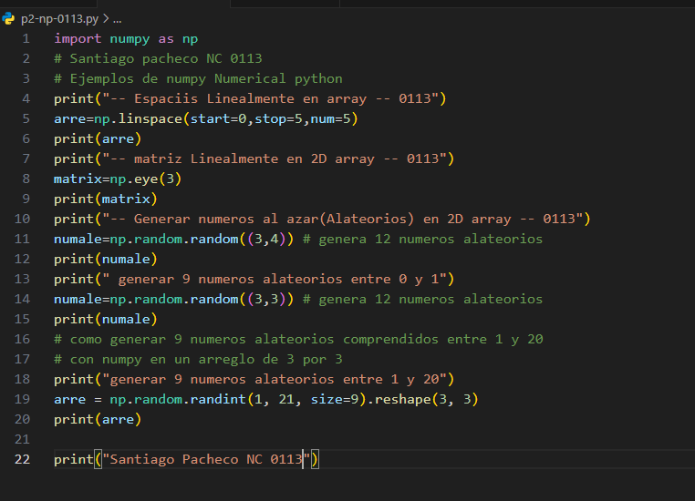
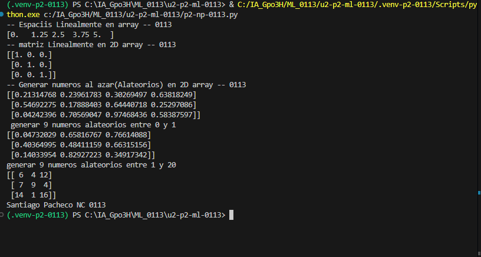

 - start=0: Indica el valor inicial del arreglo, que es 0.

- stop=1: Indica el valor final del arreglo, que es 1.

- num=5: Indica que se generarán 5 números en total.

## que es np.linspace
linspace() es una función de NumPy que genera una cantidad específica de números distribuidos uniformemente entre un valor inicial y uno final.

## El codigo

## EL resultado
